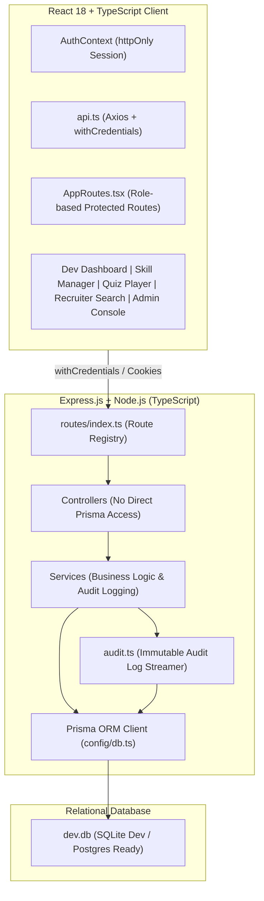

# SKILLPROOF v2: Real-Skill Verification Platform

> **"A certificate or self-declared skill is only a CLAIM. A skill becomes VERIFIED only when proven through a randomized, server-graded technical assessment."**

SKILLPROOF v2 replaces static certificates with rigorous, server-graded technical assessments. Recruiters discover candidates based solely on verified benchmark percentages and levels.

---

## 🏗 Architecture & Strict Layering



### Server Layering Rules Enforced:
`routes -> controllers -> services -> Prisma`
- **Controllers never touch Prisma directly.**
- **Every service mutating data calls `audit.ts`.**
- **Every controller responds via `response.ts` (`{ success, data, error }`).**

---

## 🎯 Core Principles & Rules

1. **Claims vs. Verification:**
   - Any uploaded certificate or self-declared skill is labeled **"Claimed"** (Unverified).
   - Skills become **"Verified"** only when passing a timed, server-graded 20-question randomized technical assessment (minimum weighted score: 40%).
   - Verification status lasts for 12 months.
2. **Assessment Randomization:**
   - Exactly 20 questions drawn per assessment: **8 EASY, 8 MEDIUM, 4 HARD**.
   - Topic spread across core language principles.
   - Questions seen in user's previous 2 attempts on that language are excluded.
3. **Strict Weighted Scoring:**
   - `EASY`: 1 point
   - `MEDIUM`: 2 points
   - `HARD`: 3 points
   - **Level Thresholds:**
     - `0 - 39%`: Beginner
     - `40 - 59%`: Basic (Pass threshold)
     - `60 - 74%`: Intermediate
     - `75 - 89%`: Advanced
     - `90 - 100%`: Expert (Requires **≥60% accuracy on HARD questions**)
4. **Anti-Abuse & Retake Policies:**
   - **7-day cooldown** between retakes for the same language.
   - **Maximum 3 attempts** per language within any rolling 30-day window.
   - 30-minute server timer enforced with focus-loss blur tracking.

---

## 🔑 Demo Seed Accounts

| Role | Email | Password | Access Capabilities |
| :--- | :--- | :--- | :--- |
| **Admin** | `admin@skillproof.dev` | `Admin@123` | Question bank CRUD, flag review, user suspension, audit logs |
| **Recruiter** | `recruiter@techcorp.com` | `Recruiter@123` | Search verified developers, filter by score/level, bookmark with notes |
| **Developer 1** | `arjun@skillproof.dev` | `Dev@123` | Verified in JS (88%) & Python (76%), 1 claimed skill, 2 projects |
| **Developer 2** | `priya@skillproof.dev` | `Dev@123` | Verified in Java (92% Expert), 2 projects |

---

## ⚡ Quick Start & Run Commands

### 1. Setup Environment & Install Dependencies
```bash
# Server dependencies
cd skillproof/server
npm install

# Client dependencies
cd ../client
npm install
```

### 2. Database Migration & Seed
```bash
cd skillproof/server

# Push Prisma schema to dev.db & generate Prisma client
npx prisma db push --force-reset
npx prisma generate

# Populate users, skills, projects, and 63 randomized questions
npx tsx src/seed.ts
```

### 3. Run Test Suite
```bash
cd skillproof/server
npx tsx src/tests/runTests.ts
```
Expected: `6 Passed, 0 Failed (100% pass)`.

### 4. Start Development Servers
In separate terminals:
```bash
# Terminal 1: Backend Server (Port 5000)
cd skillproof/server
npm run dev

# Terminal 2: Frontend Vite Client (Port 5173)
cd skillproof/client
npm run dev
```

Visit **`http://localhost:5173`** in your browser.
