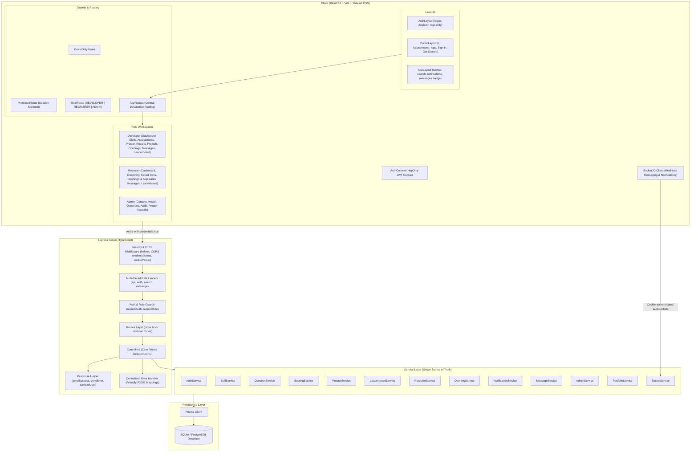

# SkillProof Platform Architecture

This document specifies the technical architecture, layer boundaries, data models, routes, services, and security invariants of the **SkillProof Real-Skill Benchmark & Verification Platform**.

---

## 1. System Overview & Architecture Diagram

SkillProof replaces self-reported resume claims and unverified certificates with tamper-proof, server-graded skill passports, real-time proctored assessments, and verifiable leaderboards.

---

## 2. Client Architecture

### 2.1 Layout Hierarchy
1. **`AuthLayout` (`client/src/layouts/AuthLayout.tsx`)**:
   - Dedicated minimal layout for `/login` and `/register`.
   - Renders only the SkillProof logo and centered form card. No navigation links, search, or badges.
2. **`PublicLayout` (`client/src/layouts/PublicLayout.tsx`)**:
   - Header with Logo, "Sign In" button, and "Get Started" / "Go to App" CTA.
   - Used for public landing (`/`), public developer portfolios (`/u/:username`), and public leaderboards.
3. **`AppLayout` (`client/src/layouts/AppLayout.tsx`)**:
   - Authenticated application shell.
   - Header contains: SkillProof logo, real-time developer search (`@username`), notification bell with unread badge, messages badge, and user dropdown.
   - Sidebar/navigation bar routed per role.

### 2.2 Route Guards & AppRoutes (`client/src/routes/AppRoutes.tsx`)
- **`GuestOnlyRoute`**: Redirects authenticated users away from `/login` and `/register` to their role dashboard.
- **`ProtectedRoute`**: Renders an animated loading skeleton while session loads (`/api/auth/session`); redirects unauthenticated users to `/login`.
- **`RoleRoute`**: Enforces role requirements (`DEVELOPER`, `RECRUITER`, `ADMIN`); redirects unauthorized users to `/403`.
- **404 Page**: Catches unmatched routes and provides recovery navigation.

### 2.3 Role-Based Page Workspaces
- **Developer**:
  - `Dashboard` (`/dashboard`): Verified skills, average verified score, active project count, recent test history.
  - `Skills` (`/skills`): Claim unverified skills, initiate proctored tests, view earned certificates.
  - `Assessments` (`/assessments`): Assessment directory and status tracking.
  - `Proctored Test` (`/assessments/:id/take`): Fullscreen testing environment with browser AI camera proctoring, timer, and tab-switch monitoring.
  - `Results` (`/assessments/:id/results`): Score breakdown, topic strengths, and verification passport.
  - `Projects` (`/projects`): Portfolio project management.
  - `Leaderboard` (`/leaderboard`): Scope-based global, track, and skill leaderboards.
  - `Openings` (`/openings`): Browse verified recruiter hiring openings and submit approaches.
  - `Messages` (`/messages`): Chat interface for accepted opening conversations.
  - `Notifications` (`/notifications`): Real-time updates for opening matches, approach decisions, and messages.
  - `Settings` (`/settings`): Profile and privacy preferences.
- **Recruiter**:
  - `Dashboard` (`/recruiter/dashboard`): Hiring pipeline metrics and recent applicants.
  - `Developer Discovery` (`/recruiter/discovery`): Talent search filtered exclusively by `VERIFIED` skills, score thresholds, and tracks.
  - `Saved Developers` (`/recruiter/saved`): Bookmarked developer candidates with recruiter notes.
  - `Openings Manage + Applicants` (`/recruiter/openings`): Publish openings, review candidate approaches, accept/decline candidates.
  - `Messages` (`/messages`): Chat with accepted applicants or directly unlocked candidates.
  - `Leaderboard` (`/leaderboard`): Public verified talent standings.
- **Admin**:
  - `Admin Console` (`/admin` via `client/src/pages/admin/AdminDashboard.tsx`): Track/Catalog/Topic management, question bank curation, question flags, user accounts, and proctoring lockout appeals.

---

## 3. Server Architecture & API Structure

### 3.1 Server Registration (`server/src/app.ts`)
The server registers middleware and routes in strict order:
1. **`helmet`**: Configured with `{ crossOriginResourcePolicy: { policy: 'cross-origin' } }` for static upload access.
2. **`cors`**: Whitelists `http://localhost:5173` with `credentials: true`.
3. **`cookieParser`**: Parses session JWT from `httpOnly` cookies.
4. **Rate Limiters**:
   - `apiRateLimiter`: 300 requests per 15 minutes.
   - `authRateLimiter`: 10 attempts per 15 minutes per IP + email.
   - `searchRateLimiter`: 60 queries per minute.
   - `messageRateLimiter`: 60 messages per minute.
5. **Routes (`server/src/routes/index.ts`)**:
   - **Public Endpoints Only**:
     - `POST /api/auth/register`, `POST /api/auth/login`, `POST /api/auth/logout`, `GET /api/auth/session`
     - `GET /api/health`
     - `GET /api/users/check-username`
     - `GET /api/public/portfolio/:username`
   - **Authenticated Endpoints**: Protected via `requireAuth` and role-specific middleware (`requireDeveloper`, `requireRecruiter`, `requireAdmin`).
6. **Centralized Error Handler**: Translates exceptions into uniform responses and safely maps Prisma `P2002` constraint errors without leaking internal database schema or raw queries.

### 3.2 Scheduled Background Jobs (`server/src/app.ts`)
- **Proctor Snapshot Cleanup**: Runs at boot and every 6 hours; permanently purges snapshot files older than 30 days.
- **Opening Expiration**: Runs hourly; transitions openings past `deadline` to `EXPIRED`.
- **Leaderboard Consistency Validation**: Runs hourly; inspects all `LeaderboardEntry` records against real `Skill` counts, auto-healing any drift.
- **Active Heartbeat Monitor**: Runs every 10 seconds; logs `NO_HEARTBEAT` violations for active assessments silent for $>30$ seconds.

### 3.3 Strict Layering: Routes -> Controllers -> Services -> Prisma
Controllers **never** import `prisma`. All database operations are encapsulated in 11 domain services:

| Service | Primary Responsibilities |
|---|---|
| `authService` | Register in atomic `$transaction`, bcrypt hashing, JWT issuance, username slug normalization. |
| `skillService` | Skill claiming (`CLAIMED`), dashboard summary calculations, user skill listings. |
| `questionService` | Blueprint stratified sampling (8 Easy / 8 Medium / 4 Hard), question exclusion from prior 2 attempts, $\ge 60$ question pool guard. |
| `scoringService` | Weighted scoring (Easy 1, Med 2, Hard 3), level thresholds, hard accuracy requirements for Expert ($\ge 60\%$), cooldown & retake caps. |
| `proctorService` | Camera event tracking, 20s strike cooldown, 3-strike termination + 2-day `SkillLockout`, snapshot storage & cleanup, appeals. |
| `leaderboardService` | Single source of truth points calculation, global/track/skill scope standings, hourly consistency self-healing. |
| `recruiterService` | Verified candidate discovery, recruiter verification checks, bookmarking with notes. |
| `openingService` | Opening lifecycle, matching developer query, developer notification dispatch. |
| `notificationService` | Real-time notifications with Socket.IO, 5/day opening match cap + digest grouping. |
| `messageService` | Opening approach workflow, per-recruiter unlock enforcement, real-time Socket.IO chat, abuse reporting. |
| `adminService` | Track/SkillCatalog/Topic CRUD, question bank curation, flag resolution, lockout appeal management. |

---

## 4. Database Schema (20+ Models)

The Prisma schema (`server/prisma/schema.prisma`) defines 27 normalized models:

1. **`User`**: Account identity (`id`, `name`, `email`, `username`, `passwordHash`, `role`, `status`, `isDemo`, `createdAt`, `updatedAt`).
2. **`DeveloperProfile`**: Developer portfolio details (`bio`, `githubUrl`, `isPublic`, `showOnLeaderboard`). Identified publicly by `User.username`.
3. **`RecruiterProfile`**: Recruiter company and verification status (`companyName`, `jobTitle`, `isVerified`, `verifiedAt`).
4. **`DeveloperInterest`**: Developer track interests (`userId`, `trackId`).
5. **`Track`**: Domain curriculum (`name`, `slug`, `description`, `icon`).
6. **`SkillCatalog`**: Benchmark curriculum (`trackId`, `name`, `slug`, `durationSec`, `questionCount`).
7. **`Topic`**: Sub-domains under a SkillCatalog with `weightPercent` (summing to 100%).
8. **`Question`**: Verified question pool (`skillCatalogId`, `language`, `topic`, `difficulty`, `options`, `correctAnswer`, `status`).
9. **`Skill`**: Developer skill record (`userId`, `skillCatalogId`, `language`, `status` [CLAIMED | VERIFIED], `claimedLevel`, `certificateUrl`, `bestScore`, `verifiedAt`, `expiresAt`).
10. **`Assessment`**: Test attempt (`userId`, `skillCatalogId`, `language`, `status` [IN_PROGRESS | SUBMITTED | EXPIRED | TERMINATED], `scorePercent`, `weightedPercent`, `level`, `tabSwitchCount`, `lastHeartbeatAt`).
11. **`AssessmentQuestion`**: Questions assigned to an assessment (`assessmentId`, `questionId`, `order`, `userAnswer`, `isCorrect`).
12. **`ProctorEvent`**: Camera violations (`assessmentId`, `userId`, `type`, `counted`, `snapshotUrl`, `metadata`).
13. **`SkillLockout`**: 2-day penalty (`userId`, `skillCatalogId`, `reason`, `until`, `liftedByAdmin`, `confirmedByAdmin`, `appealText`).
14. **`LeaderboardEntry`**: Standings (`userId`, `scope`, `scopeId`, `period`, `points`, `rank`, `verifiedSkillsCount`).
15. **`Project`**: Portfolio projects (`userId`, `title`, `description`, `repoUrl`, `techStack`).
16. **`Bookmark`**: Recruiter saved candidates (`recruiterId`, `developerId`, `note`).
17. **`Opening`**: Recruiter job openings (`recruiterId`, `trackId`, `title`, `description`, `minScore`, `minLevel`, `status`).
18. **`OpeningSkill`**: Skills required by an opening (`openingId`, `skillCatalogId`).
19. **`Approach`**: Developer approach to an opening (`openingId`, `developerId`, `intro`, `status` [PENDING | ACCEPTED | DECLINED]).
20. **`Conversation`**: Direct hiring message channel (`userAId`, `userBId`, `openingId`, `status`, `lastMessageAt`).
21. **`ConversationParticipant`**: Chat membership (`conversationId`, `userId`, `status`, `lastReadAt`).
22. **`Message`**: Real-time message (`conversationId`, `senderId`, `body`, `createdAt`).
23. **`UserBlock`**: User communication blocks (`blockerId`, `blockedId`).
24. **`MessageReport`**: Flagged messages (`messageId`, `reporterId`, `reason`, `resolved`).
25. **`Notification`**: System notifications (`userId`, `type`, `title`, `body`, `entityType`, `entityId`, `readAt`).
26. **`QuestionFlag`**: Test question feedback (`questionId`, `userId`, `reason`, `status`).
27. **`AuditLog`**: Immutable audit ledger (`userId`, `action`, `entityType`, `entityId`, `metadata`, `ipAddress`).

---

## 5. Core Invariants & Security Rules

### 5.1 Verified Skills Only for Discovery & Leaderboard
- Recruiter discovery searches filter strictly by `skills.some(status == 'VERIFIED' && bestScore >= minScore)`. Claimed (unverified) skills are never returned in discovery queries.
- The leaderboard points formula tallies points exclusively from `VERIFIED` skills.

### 5.2 Hiring Messaging & Per-Recruiter Unlock Flow
- **Developer Restrictions**: A developer can NEVER initiate direct chat with another developer or arbitrary recruiter.
- **Opening Flow**: A developer can approach a verified recruiter only through an active, matching opening. The recruiter accepts or declines. Acceptance unlocks chat for that specific recruiter-developer pair.
- **Direct Flow**: A verified recruiter can message an eligible developer directly, which unlocks the conversation for that pair.

### 5.3 AI Camera Proctoring & Lockout Rules
- Client processes camera feed locally with TensorFlow.js (`COCO-SSD` + `BlazeFace`). Raw video is never transmitted.
- 1st & 2nd violations: Warning issued with a 20-second strike cooldown.
- 3rd strike: Assessment is immediately set to `TERMINATED` (no score, no level, no verification), and a 2-day `SkillLockout` is created for that specific skill.
- Snapshots are retained for 30 days max and are viewable only by admins.

### 5.4 Zero Email & PasswordHash Leakage
- User DTOs across all public and authenticated endpoints exclude `email` and `passwordHash`.
- Users and candidates are identified by `@username`.

### 5.5 Multi-Surface Score Consistency
- The benchmark score (e.g., 85% Advanced) matches identically across:
  1. Developer Dashboard (`SkillService.getDashboardSummary`)
  2. Skills Manager (`SkillService.getUserSkills`)
  3. Leaderboard (`LeaderboardService.getLeaderboard`)
  4. Public Portfolio (`PortfolioService.getPublicPortfolioBySlug`)
