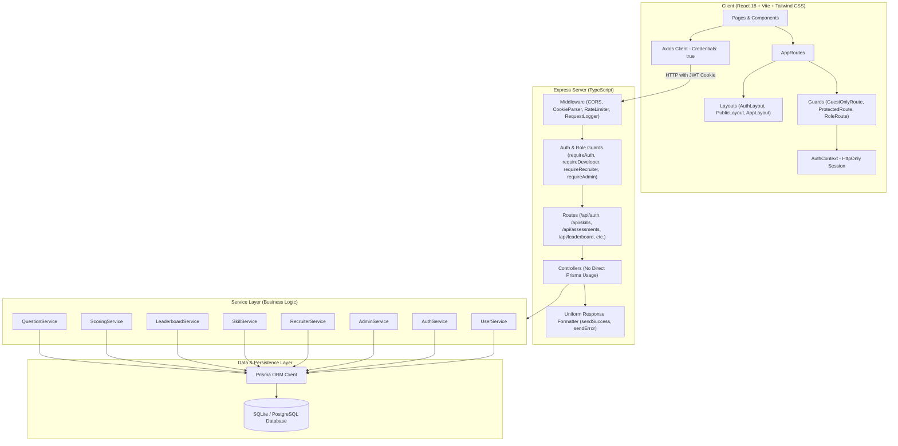

# SkillProof Platform Architecture

This document describes the architectural structure, design patterns, security model, and data schemas of the **SkillProof Real-Skill Benchmark & Verification Platform**.

---

## 1. System Overview & Architecture Diagram

SkillProof replaces self-reported resume claims and unverified certificates with tamper-proof, server-graded skill passports and verifiable leaderboards.

---

## 2. Layered Architecture

SkillProof enforces strict separation of concerns across 4 primary layers:

### 2.1 Presentation & Client Routing Layer (`client/src/`)
- **AppRoutes (`client/src/routes/AppRoutes.tsx`)**: Central route declarations separating public, auth, and application workflows.
- **Layouts (`client/src/layouts/`)**:
  - `AuthLayout`: Minimal, focused container for authentication flows (`/login`, `/register`).
  - `PublicLayout`: Includes `Navbar` and `Footer` for landing, public portfolios (`/u/:username`), and global leaderboard (`/leaderboard`).
  - `AppLayout`: Shell for authenticated application workspaces (`/dashboard`, `/skills`, `/assessments`, `/projects`, `/admin`, `/recruiters/bookmarks`).
- **Guards (`client/src/routes/`)**:
  - `GuestOnlyRoute`: Redirects authenticated users directly to their designated role dashboard.
  - `ProtectedRoute`: Ensures session validity; shows skeleton while loading, redirects unauthenticated visitors to `/login`.
  - `RoleRoute`: Enforces role-based permissions (`DEVELOPER`, `RECRUITER`, `ADMIN`), redirecting unauthorized users to `/403`.

### 2.2 API & Controller Layer (`server/src/controllers/`, `server/src/routes/`)
- **No Direct Database Access**: Controllers **never** import `prisma` directly. They handle input sanitation, delegate to services, and format responses.
- **Uniform Response Format (`server/src/utils/response.ts`)**:
  - Success: `{ success: true, message: string, data: any }`
  - Failure: `{ success: false, message: string, errors?: any[] }`
- **Security & Privacy**:
  - Authentication tokens are transmitted in `httpOnly`, `sameSite: 'lax'` cookies.
  - **Zero Email / PasswordHash Leakage**: Responses never expose user emails or password hashes in client-facing payloads. Users are identified by `@username`.
  - Multi-tiered rate limiting: `apiRateLimiter`, `authRateLimiter`, `searchRateLimiter`.

### 2.3 Service Layer (`server/src/services/`)
1. **QuestionService (`questionService.ts`)**:
   - Blueprint Stratified Sampling: Selects 20 questions according to topic weights with strict `8 Easy / 8 Medium / 4 Hard` distribution.
   - Retake Exclusion: Questions from the user's last 2 submitted attempts are excluded.
   - Pool Health Guard: Blocks assessment start if the active skill pool has $< 60$ questions. Warns administrators if any topic has $< 15$ questions.
2. **ScoringService (`scoringService.ts`)**:
   - Difficulty Weights: Easy (1 pt), Medium (2 pts), Hard (3 pts).
   - Canonical normalization and set-equality answer validation.
   - Level derivation: Basic ($40\text{--}59\%$), Intermediate ($60\text{--}74\%$), Advanced ($75\text{--}89\%$), Expert ($\ge 90\%$ AND $\ge 60\%$ on Hard questions).
   - Topic breakdown, coverage tracking, confidence calculation (`Low`, `Medium`, `High`), and retake cooldown evaluation.
3. **LeaderboardService (`leaderboardService.ts`)**:
   - Real Database Single Source of Truth: Points are calculated exclusively from verified `Skill` and submitted `Assessment` records.
   - Multi-factor formula: $\sum (\text{bestScore} \times \text{levelMultiplier}) + \text{hardBonuses} + \text{breadthBonus} (+25) + \text{weeklyBonus} (+5)$.
   - Real-time transactions: Recalculates user entries and assigns ranks atomically on test submission.
   - Safety Net: Self-healing consistency check ensures `entry.verifiedSkills` count exactly matches active `Skill` records in DB.
4. **SkillService (`skillService.ts`)**:
   - Manages developer claimed skills (unverified certificate links) and verified skills.
   - Computes dashboard statistics (verified count, claimed count, average score).
5. **RecruiterService (`recruiterService.ts`)**:
   - Discovery of candidates with verified skill passports.
   - Candidate bookmarking with recruiter notes.
6. **AdminService (`adminService.ts`)**:
   - Track, SkillCatalog, and Topic CRUD with question pool health metrics.
   - Question bank curation and batch CSV/JSON ingestion.
   - Question flag moderation, user management, and system audit trails.

### 2.4 Data Persistence Layer (`server/prisma/schema.prisma`)
The SQLite/PostgreSQL schema consists of 12 normalized models:
- `User`: Primary account record with unique `username`, `email`, `role`, and `isDemo` flag.
- `DeveloperProfile`: Bio, GitHub link, public slug, and leaderboard visibility.
- `Track`: High-level curriculum domain (e.g., UI/Frontend, ML Engineer, AI Engineer, Core).
- `SkillCatalog`: Language/technology catalog under a Track with duration and question count parameters.
- `Topic`: Sub-domains under a SkillCatalog with weighted percentages summing to 100%.
- `Question`: Question bank items with options, canonical answers, difficulty, topic, and active status.
- `Skill`: Developer's skill passport (`CLAIMED` certificate or `VERIFIED` assessment score).
- `Assessment`: Timed test attempt with score, level, topic breakdown, coverage, and confidence.
- `AssessmentQuestion`: Individual question instance in an assessment with user answer and correctness.
- `LeaderboardEntry`: Precomputed leaderboard standings across `GLOBAL`, `TRACK`, and `SKILL` scopes.
- `Bookmark`: Recruiter bookmarks of developer profiles.
- `QuestionFlag`: In-test problem flags raised by developers.
- `AuditLog`: Immutable administrative and system action ledger.

---

## 3. Security, Anti-Cheat, & Integrity Controls

1. **Server-Side Grading & Timing**:
   - Assessment durations are enforced on the server; expired attempts are locked.
   - Correct answers are never sent to the client during an ongoing assessment.
2. **Anti-Cheat Monitoring**:
   - Real-time blur/tab-switch tracking increments `tabSwitchCount`. Attempts with $\ge 3$ tab switches are excluded from the leaderboard.
3. **Stratified Blueprint Randomization**:
   - Eliminates answer memorization by dynamically sampling questions from the pool across topic weights.
   - Excludes questions seen in the candidate's previous 2 attempts.
4. **Cooldown Enforcement**:
   - 7-day cooldown between retakes per skill.
   - Maximum 3 attempts per skill in a rolling 30-day window.

